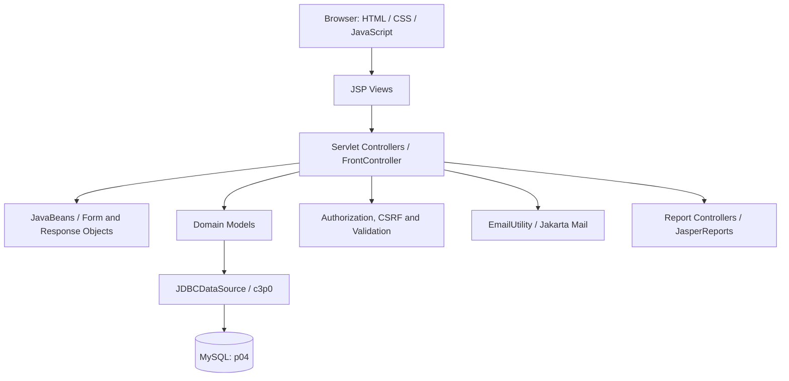

# ORSV0 — Online Result System

**Release:** 2.1.1  
**Build ID:** `ORS-2.1.1-RELEASE-20261015`  
**Project type:** Academic Software Engineering project

ORSV0 is a Java web application for managing academic structures and course-wise student results. It supports administrative maintenance, Program Chair / HOD oversight, faculty course and subject assignments, enrollment management, subject-wise marks entry, student marksheets, peer benchmarks, and password-reset email workflows.

> **Repository safety:** This project includes a fresh-demo SQL script that drops and recreates the MySQL database named `p04`, as well as demo accounts and sample data. Review and sanitize demo personal data and default credentials before publishing a public repository. Never commit real database credentials, SMTP passwords, tokens, private keys, backups, or production data.

## Contents

- [Features](#features)
- [Technology stack](#technology-stack)
- [Architecture](#architecture)
- [Database overview](#database-overview)
- [Prerequisites](#prerequisites)
- [Setup for local development](#setup-for-local-development)
- [Build and test](#build-and-test)
- [Deploy to Tomcat](#deploy-to-tomcat)
- [Configuration reference](#configuration-reference)
- [Security notes](#security-notes)
- [Testing and current limitations](#testing-and-current-limitations)
- [Project structure](#project-structure)
- [Documentation](#documentation)

## Features

### Administrator

- Manage users and roles.
- Maintain colleges, courses, subjects, student records and faculty records.
- Maintain enrollment and faculty allocation records.
- Access system-level lists and reports.

### Program Chair / HOD

- View a departmental audit and enrollment analysis dashboard.
- Review course counts, active enrollments, faculty allocations and the course/subject hierarchy.
- Review course and subject averages within the authorized college scope.
- Receive an access-denied response when an unauthorized role requests a restricted resource.

### Faculty

- View assigned courses, subjects and student rosters.
- Enter and update marks for a student’s active course enrollment.
- Use server-side checks to reject mismatched student/roll-number combinations and invalid course/subject assignments.

### Student

- View course-wise marksheets, subject marks, result status and percentages.
- Compare a result with the available class/subject benchmark or merit list.
- View and update profile details and change a password.

### Shared functionality

- Login and role-based navigation.
- Registration, profile and password management screens.
- Forgot-password flow using single-use reset tokens and email delivery.
- English/Hindi language UI support.
- List/search and report screens, with PDF/DOC-oriented reporting features where supported by the respective view.
- CSRF protection, session controls, centralized validation messages and REST controllers.

## Technology stack

| Area | Technology |
|---|---|
| Language / source compatibility | Java; Maven compiler source/target set to Java 11 |
| Web layer | Jakarta Servlets 6.0, Jakarta Server Pages (JSP) 3.1 |
| View layer | JSP, HTML, CSS, JavaScript, bundled Bootstrap assets and icons |
| Application pattern | Model–View–Controller (MVC) with JavaBeans, models and servlet controllers |
| Build and package | Apache Maven; WAR packaging |
| Web container used in local verification | Apache Tomcat 11.0.26 |
| Database | MySQL, default schema `p04` |
| Persistence | JDBC and c3p0 connection pooling |
| Email | Jakarta Mail / SMTP |
| JSON support | Jackson |
| Reports | JasperReports |
| Logging | Log4j 2 |
| Automated tests | JUnit 5, Mockito and HSQLDB for selected in-memory tests |

The `pom.xml` is the authoritative dependency/version list. The project targets Java 11 bytecode; the local project verification described by the team used Java 17, Maven, Tomcat 11.0.26, MySQL and Chrome DevTools.

## Architecture

ORSV0 uses an MVC-style layered design:



- **Views:** `src/main/webapp/jsp/` contains login, welcome, list, form, marksheet, audit and report views.
- **Controllers:** `src/main/java/com/sunilos/p4/ctl/` contains servlet controllers, including the front controller, authentication, enrollment, marksheet, faculty allocation and audit workflows.
- **Models:** `src/main/java/com/sunilos/p4/model/` contains business and persistence logic, including `BaseModel`, `UserModel`, `EnrollmentModel`, `MarksheetModel`, and domain-specific models.
- **Beans:** `src/main/java/com/sunilos/p4/bean/` holds the data objects passed between views, controllers and models.
- **Utilities and REST:** utility classes provide validation, data conversion, email, password and JDBC functions; REST controllers are in `src/main/java/com/sunilos/p4/rest/`.
- **Cross-cutting controls:** authorization, marksheet access, language handling and performance observation are implemented through controller/filter and utility code.

## Database overview

The fresh-demo schema is named **`p04`**. The canonical application uses 11 main tables:

| Table | Purpose |
|---|---|
| `st_role` | Role definitions: Admin, Student, Program Chair and Faculty |
| `st_user` | Authentication identity, role and account/security metadata |
| `st_college` | College/institution records |
| `st_course` | Course/program catalogue |
| `st_subject` | Subject/module records linked to a course via `COURSE_ID` |
| `st_student` | Student profile and college association |
| `st_faculty` | Faculty profile and college association |
| `st_enrollment` | Student-to-course enrollment, roll number, semester/year and status |
| `st_faculty_allocation` | Faculty-to-course/subject assignments |
| `st_marksheet` | Normalized subject-level marks linked to student, course and subject |
| `st_password_reset_token` | Hashed, single-use password-reset tokens and expiration data |

### Important relationships

- A course can have multiple subjects (`st_subject.COURSE_ID`).
- Students may have course enrollments recorded in `st_enrollment`; only eligible active enrollments should be used by enrollment-sensitive workflows.
- Faculty allocations connect a faculty member to a course and, where specified, a subject.
- Marksheet records carry student, course, subject and marks information. Result queries must respect student ownership, active enrollment and role/college scope where applicable.
- Program Chair averages are scoped to the Chair’s authorized college. In the verified demo data, the JIU Java/String marks of 89 and 88 produce `88.50%`; the broader five-student benchmark is a different population and produces `86.80%`.

### Database setup safety

`database/ORSV0_Fresh_p04_Setup.sql` is **destructive**: it contains `DROP DATABASE IF EXISTS p04` and recreates the schema. Run it only when intentionally resetting a disposable local demo database. It permanently deletes the existing `p04` database and its data.

For an existing database, do not run the fresh setup script. Back up the database and review the appropriate migration scripts and their comments first:

- `database/migrations/V2__audit_remediation_migration.sql`
- `database/migrations/V3__align_p04_schema_to_orsv0.sql`

These are schema-sensitive scripts; read their preflight, compatibility and preservation notes, and test on a backup/copy before applying them to data you need to keep.

## Prerequisites

- JDK 11 or newer (Java 17 was used during local verification).
- Apache Maven 3.8 or newer on `PATH`.
- MySQL 8.x (or a compatible MySQL server) for the live application.
- Apache Tomcat configured for the Jakarta Servlet/JSP application.
- A disposable database environment for the fresh demo SQL script.
- SMTP credentials if testing password-reset email or integration tests that exercise email configuration.

## Setup for local development

### 1. Clone or copy the source

Keep `pom.xml` at the repository root. Run all Maven and helper-script commands from that directory.

```bash
git clone <your-repository-url>
cd ORSV0
```

Replace `<your-repository-url>` with the URL of your GitHub repository.

### 2. Prepare the database

For a new, disposable local demo environment, open `database/ORSV0_Fresh_p04_Setup.sql` in MySQL Workbench and execute it after confirming you can safely delete any existing `p04` database. The script creates the database, tables and demo seed records.

**Do not run that script against a database containing data you need to preserve.** Back up an existing database before any migration.

### 3. Configure environment variables

Set credentials in the environment of the process that will launch Tomcat. Do not hard-code secrets in `system.properties` or commit them to Git. Example for a temporary Windows PowerShell session (replace the placeholders locally):

```powershell
$env:ORS_DB_URL = "jdbc:mysql://localhost:3306/p04"
$env:ORS_DB_USER = "root"
$env:ORS_DB_PASSWORD = "<your-local-mysql-password>"

$env:ORS_SMTP_HOST = "smtp.gmail.com"
$env:ORS_SMTP_PORT = "587"
$env:ORS_SMTP_USER = "<your-sending-email-address>"
$env:ORS_SMTP_PASSWORD = "<your-email-provider-app-password>"
```

These variables apply only to the current PowerShell process and its child processes. Start Tomcat from a process that has the required variables set. For Gmail, use an App Password where required by the account configuration; do not use or publish your ordinary account password.

The default configuration is in `src/main/resources/com/sunilos/p4/bundle/system.properties`. Environment variables override the supported database and SMTP settings. `ORS_PASSWORD_PEPPER` is optional, but if enabled it must remain stable for hashes created with that pepper to verify correctly.

### 4. Build and run tests

```bash
mvn clean test package
```

A successful package creates:

```text
target/ORSV0.war
```

Read the final Maven test summary from the build you just ran; do not rely on old reports under `target/`. Some integration tests exercise password-reset email configuration, so configure the needed SMTP values before running the full suite if the test environment requires them.

## Deploy to Tomcat

### Windows helper script

Set `TOMCAT_HOME` to your own Tomcat installation. Review the helper script before executing it; its `--deploy` mode replaces the existing `ORSV0` deployment only.

```powershell
$env:TOMCAT_HOME = "C:\path\to\apache-tomcat"
.\run.bat --deploy
```

Start/restart Tomcat using the startup scripts for your installation. Keep the required database and SMTP environment variables available to the Tomcat process.

### Linux / macOS helper script

```bash
export TOMCAT_HOME=/path/to/apache-tomcat
./deploy.sh --deploy
```

### Verify the application

With Tomcat running, open:

```text
http://localhost:8080/ORSV0/
```

The project’s health/version endpoint used during local monitoring is:

```text
http://localhost:8080/ORSV0/version
```

The `/version` endpoint should be checked after deployment to confirm the expected build is running. If the health endpoint is unavailable, confirm the WAR deployed successfully, the context path is `ORSV0`, and Tomcat logs show no startup or database errors.

## Configuration reference

| Variable | Purpose | Typical local value |
|---|---|---|
| `ORS_DB_DRIVER` | JDBC driver class | `com.mysql.cj.jdbc.Driver` |
| `ORS_DB_URL` | JDBC connection URL | `jdbc:mysql://localhost:3306/p04` |
| `ORS_DB_USER` | Database username | Local MySQL account |
| `ORS_DB_PASSWORD` | Database password | Set privately in environment |
| `ORS_PASSWORD_PEPPER` | Optional password-hash pepper | Unset unless deliberately configured and managed |
| `ORS_SMTP_HOST` | SMTP server hostname | `smtp.gmail.com` |
| `ORS_SMTP_PORT` | SMTP port | `587` in the verified local configuration |
| `ORS_SMTP_USER` | SMTP login/sender account | Set privately in environment |
| `ORS_SMTP_PASSWORD` | SMTP password or provider App Password | Set privately in environment |

## Security notes

- Passwords created/updated by the application use PBKDF2-HMAC-SHA-256 with 65,536 iterations and a unique random salt. Legacy SHA-256 password digests are handled through the migration logic described in the source README and password utility code.
- Password reset uses expiring, single-use hashed reset tokens; email delivery must be configured for the workflow to complete.
- Server-side authorization restricts protected controllers and data to permitted roles and scope. Do not rely on menu visibility as the only access control.
- Student result queries should limit students to their own results, and faculty grading should validate the selected student’s active enrollment, roll number, course and subject.
- Never commit `.env` files, passwords, Gmail App Passwords, API keys, private certificates, production exports, database backups or runtime logs.
- Before making the repository public, review seed SQL and documentation for demo names, contact details and default demo credentials. Replace sensitive or personally identifying seed data with fictional values where possible.

## Testing and current limitations

The repository contains JUnit 5 tests under `src/test/java`, including tests for controller access/CSRF behavior, validation, password utilities, user logic, enrollment/marksheet logic, and database integration/latency behavior. Run `mvn clean test package` for a fresh result.

During the team’s local verification, the following behaviors were demonstrated through application screenshots and reported build output:

- Student login and course-wise marksheet retrieval.
- Faculty saving marks for a valid active enrollment.
- Program Chair Department Audit, including college-scoped Java/String average and subject-level average display.
- Server-side denial of a Student’s direct request for a restricted Program Chair Audit URL.
- SMTP configuration using port 587 and password-reset email delivery.
- A reported Maven run with 43 tests, zero failures, zero errors and zero skipped; rerun tests on the current checkout to confirm the result for your environment.
- Sample Chrome Network timings were low in local tests, but they are single-request observations rather than a formal load/stress test.

**Not certified by the available local evidence:** sustained production availability, a seven-day uptime result, performance under representative concurrent load, and production deployment hardening. The uptime monitoring script records sampled local endpoint availability only; it does not by itself prove a 99.5% production SLA.

## Project structure

```text
ORSV0/
├── pom.xml
├── README.md
├── .gitignore
├── run.bat
├── deploy.sh
├── Create-CleanRelease.ps1
├── Monitor-ORSV0-Uptime.ps1
├── database/
│   ├── ORSV0_Fresh_p04_Setup.sql
│   ├── demo_ors.sql
│   ├── demo_seed_data.sql
│   └── migrations/
│       ├── V2__audit_remediation_migration.sql
│       └── V3__align_p04_schema_to_orsv0.sql
├── docs/
│   └── REQUIREMENTS_TRACEABILITY_AND_UML.md
└── src/
    ├── main/
    │   ├── java/com/sunilos/p4/
    │   │   ├── bean/
    │   │   ├── ctl/
    │   │   ├── exception/
    │   │   ├── model/
    │   │   ├── rest/
    │   │   ├── tag/
    │   │   └── util/
    │   ├── resources/com/sunilos/p4/bundle/
    │   │   └── system.properties
    │   └── webapp/
    │       ├── WEB-INF/web.xml
    │       ├── css/
    │       ├── js/
    │       └── jsp/
    └── test/java/com/sunilos/p4/
```

## Documentation

- `docs/REQUIREMENTS_TRACEABILITY_AND_UML.md` — requirements mapping and UML/traceability notes.
- `FIXES_APPLIED_2026-10-15.md` — summary of applied code fixes and build/deployment notes.
- `README_AUDIT_FIXES.md` — audit-remediation information.
- `RESULTS_TROUBLESHOOTING.md` — guidance for diagnosing missing or incorrect result data.
- `CSRF_TOKEN_FIX_GUIDE.md` — CSRF troubleshooting.
- `JASPERREPORTS_TUTORIAL.md` — reporting notes.
- Experiments 1–9 in the academic project documentation — user stories, quality requirements, UML/DFD models, test cases and verification evidence.

## License

No license is declared in this source snapshot. Add a `LICENSE` file before publishing if you intend to permit reuse or contributions; otherwise, users should treat the code as having no granted open-source license.
