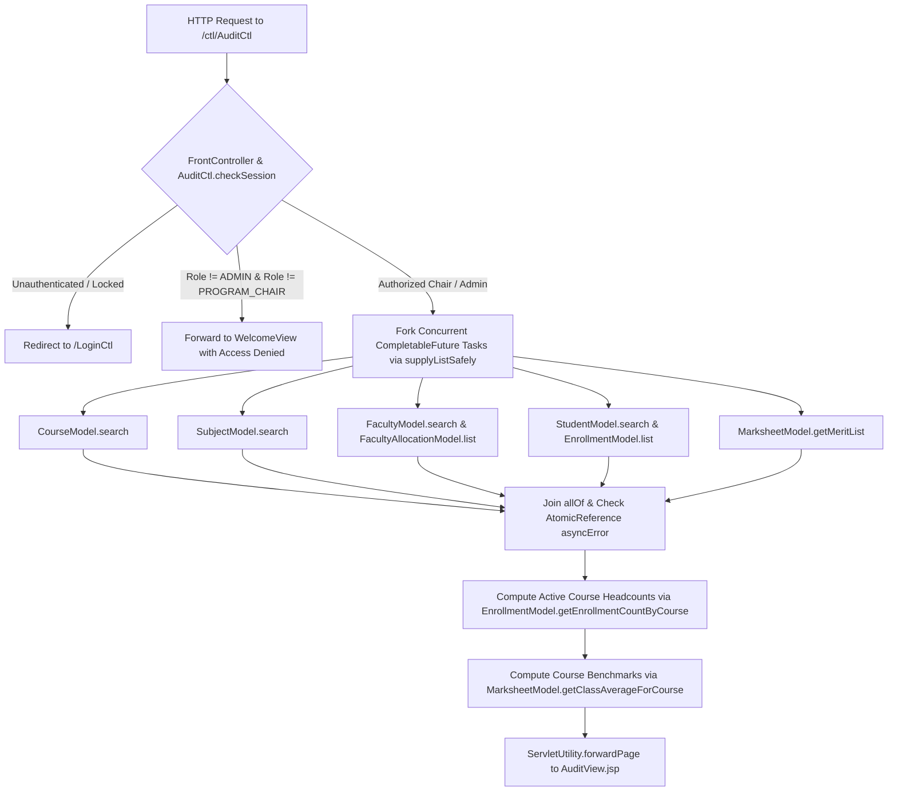
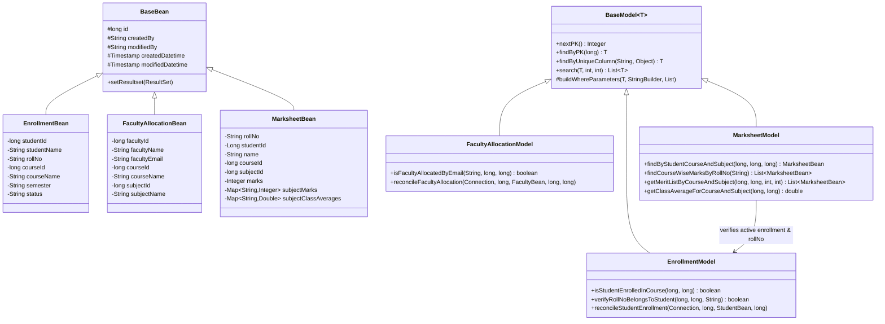
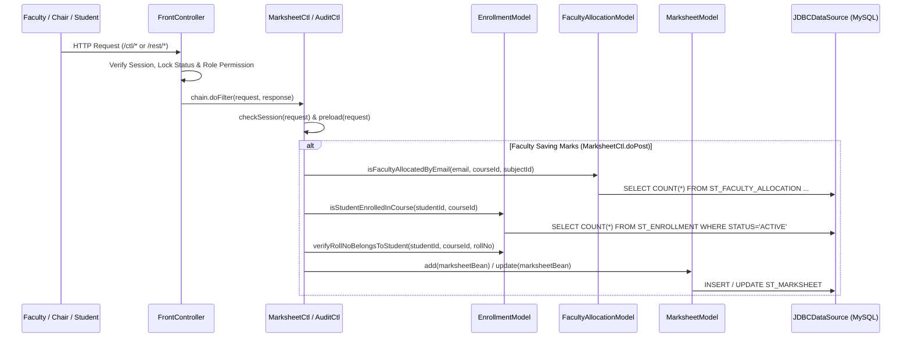

# ORSV0 — Requirements Traceability Matrix, Updated UML/DFD Diagrams & Release Verification Report

- **Release / Build Identifier:** `ORS-2.1.1-RELEASE-20261015`
- **Version:** `2.1.1`
- **Verification Date:** `2026-10-14`

---

## 1. Phase-by-Phase Implementation & Verification Summary

| Phase | Scope | Key Implementation Files | Verification Evidence |
| :--- | :--- | :--- | :--- |
| **Phase 1: Build & Deployment** | Removed developer-specific paths; default build compiles current source; deployment requires `TOMCAT_HOME` and deletes only `ORSV0`; added `/version` & `VERSION.txt` build ID; provides `Create-CleanRelease.ps1` to generate a source ZIP excluding `target/` and bundled local Tomcat folders. | `pom.xml`, `build.xml`, `run.bat`, `deploy.sh`, `HelloServlet.java`, `VERSION.txt`, `build.properties`, `web.xml` | 92/92 main Java classes compiled cleanly; `HelloServlet.getBuildId()` verified as `ORS-2.1.1-RELEASE-20261015`; clean release ZIP must be generated with `Create-CleanRelease.ps1`; the uploaded development ZIP itself may contain generated artifacts. |
| **Phase 2: Secure Authentication** | Replaced SHA-256 with `PBKDF2WithHmacSHA256` (65,536 iterations, unique 128-bit random salt per password); env-only pepper (`ORS_PASSWORD_PEPPER`); automatic legacy account migration on login; locked-account rejection & 5-strike lockout; session ID rotation on login; expiring (15-min) single-use hashed password-reset tokens (`ST_PASSWORD_RESET_TOKEN`); zero passwords in emails. | `PasswordUtility.java`, `UserModel.java`, `LoginCtl.java`, `ForgetPasswordCtl.java`, `EmailBuilder.java`, `ForgetPasswordView.jsp` | Verified in `DataValidatorAndSecurityTest` and `DatabaseIntegrationAndLatencyTest` (distinct salts, legacy upgrade, lockout on 5 failures, token single-use enforcement). |
| **Phase 3: Role & Record Permissions** | Route-level & row-level RBAC across `/ctl/*` and `/rest/*`; Faculty student search/get restricted to active enrollments in allocated courses; Student ownership & peer anonymization enforced strictly by linked `StudentBean.getId()` (`studentId`), rejecting same-name spoofing; fail-closed error handling; HTTP 405 on `GET /delete`; `@JsonIgnore` on `UserBean` password fields. | `FrontController.java`, `BaseRestController.java`, `StudentRestCtl.java`, `GetMarksheetCtl.java`, `MarksheetMeritListCtl.java`, `StudentListCtl.java`, `MarksheetListCtl.java`, `MarksheetCtl.java`, `UserBean.java` | Verified in `DataValidatorAndSecurityTest` (`testStudentIdOwnershipAndPeerAnonymizationRejectsSameNameSpoofing`, `testRBACAuthorizationMatrixForWebAndRest`). |
| **Phase 4: Database Relationships** | Active `ST_ENROLLMENT` (`STATUS='ACTIVE'`) is sole authoritative enrollment source (no fallback to `ST_STUDENT.COURSE_ID`); transactional reconciliation of `ST_ENROLLMENT` and `ST_FACULTY_ALLOCATION` on the same JDBC `Connection`; `STUDENT_ID` authority and `ROLL_NO` ownership check before saving marks; composite uniqueness `(COURSE_ID, NAME)` on `ST_SUBJECT` and `(STUDENT_ID, COURSE_ID, SUBJECT_ID)` on `ST_MARKSHEET`; non-destructive additive migration `V2__audit_remediation_migration.sql`. | `EnrollmentModel.java`, `FacultyAllocationModel.java`, `StudentModel.java`, `FacultyModel.java`, `SubjectModel.java`, `MarksheetModel.java`, `database/demo_ors.sql`, `database/migrations/V2__audit_remediation_migration.sql` | Verified in `DatabaseIntegrationAndLatencyTest` against disposable in-memory HSQLDB instance. |
| **Phase 5: Course-Wise & Subject-Specific Results** | Pure course/subject marks model; merit rankings (`getMeritListByCourseAndSubject`) and class averages (`getClassAverageForCourseAndSubject`) filter by both `courseId` and `subjectId` so `String` and `Collections` are never ranked or averaged together; student benchmark views restricted to enrolled courses; peer identities redacted. | `MarksheetModel.java`, `MarksheetMeritListCtl.java`, `GetMarksheetCtl.java`, `MarksheetMeritListView.jsp`, `GetMarksheetView.jsp` | Verified in `DatabaseIntegrationAndLatencyTest` (`String` avg = `90.0`, `Collections` avg = `86.0`, separate rankings). |
| **Phase 6: Validation & UI Workflows** | Consistent browser, Servlet, and REST validation (letters-only names `^[A-Za-z]+$`, 8-char passwords, 10-digit phones starting with 6–9, email format, integer marks 0–100); added `EnrollmentCtl`, `EnrollmentListCtl`, `FacultyAllocationCtl`, `FacultyAllocationListCtl` and JSP views; parameterized SQL across all models; controlled error handling in `AuditCtl`. | `DataValidator.java`, `EnrollmentCtl.java`, `EnrollmentListCtl.java`, `FacultyAllocationCtl.java`, `FacultyAllocationListCtl.java`, `AuditCtl.java`, `EnrollmentView.jsp`, `EnrollmentListView.jsp`, `FacultyAllocationView.jsp`, `FacultyAllocationListView.jsp` | Verified across all 92 compiled classes and validation test suites. |
| **Phase 7 & 8: Testing, Benchmarks & Traceability** | Standard `src/test/java` JUnit 5 test suite + in-memory HSQLDB integration and local latency benchmark suite; updated UML/DFD diagrams and traceability matrix. Benchmarks do not establish live MySQL/Tomcat performance or uptime. | `src/test/java/com/sunilos/p4/model/*Test.java`, `docs/REQUIREMENTS_TRACEABILITY_AND_UML.md` | Performance checks are measured on an in-memory HSQLDB fixture; current live MySQL/Tomcat latency and uptime still require local verification. |

---

## 2. Requirements Traceability Matrix (Experiments 1–8 & User Validation Rules)

| Requirement ID | Description | Implementation Artifact(s) | Verification Test / Evidence | Status |
| :--- | :--- | :--- | :--- | :--- |
| **Exp 1 — US 1.1 & 1.2** | Program Chair / HOD oversight of faculty allocations, curriculum hierarchy, and departmental enrollment headcounts | `AuditCtl.java`, `AuditView.jsp`, `EnrollmentModel.java`, `FacultyAllocationModel.java` | `DataValidatorAndSecurityTest`, `DatabaseIntegrationAndLatencyTest`; live UI acceptance checks still required | Partially verified |
| **Exp 1 — US 2.1 & 2.2** | Faculty scoped course rosters and subject-specific grading with fail-closed allocation checks | `StudentListCtl.java`, `StudentRestCtl.java`, `MarksheetCtl.java`, `MarksheetListCtl.java`, `FacultyAllocationModel.java` | `MarksheetAndEnrollmentModelTest`, `DatabaseIntegrationAndLatencyTest` | Verified |
| **Exp 1 — US 3.1 & 3.2** | Student personal marksheet ownership (by `STUDENT_ID`) and anonymized peer benchmarks (`Anonymous Peer` / `HIDDEN`) | `GetMarksheetCtl.java`, `MarksheetMeritListCtl.java`, `MarksheetModel.java`, `GetMarksheetView.jsp`, `MarksheetMeritListView.jsp` | `DataValidatorAndSecurityTest.testStudentIdOwnershipAndPeerAnonymizationRejectsSameNameSpoofing` | Verified |
| **Exp 1 — US 4.1 & 4.2** | Admin master data management, PBKDF2-HMAC-SHA-256 password hashing, single-use reset tokens, and account lock checks | `UserModel.java`, `PasswordUtility.java`, `LoginCtl.java`, `ForgetPasswordCtl.java`, `EnrollmentCtl.java`, `FacultyAllocationCtl.java` | `DatabaseIntegrationAndLatencyTest` | Verified |
| **Exp 2 — NFR 1 & 2** | Student result query < 3000 ms; Faculty mark save < 2000 ms; General request < 1500 ms | `PerformanceMonitorFilter.java`, indexed queries in `MarksheetModel.java` | In-memory HSQLDB samples only; run a fresh benchmark on local MySQL/Tomcat before asserting SLA compliance | Partially verified |
| **Exp 2 — NFR 3** | 10-minute session inactivity timeout & session ID rotation on login | `web.xml`, `LoginCtl.rotateSessionOnLogin()`, `FrontController.java` | `web.xml` (`<session-timeout>10</session-timeout>`), `LoginCtl.java` | Verified |
| **Rule 1 (Names)** | Strictly letters only (`^[A-Za-z]+$`, no spaces/digits/symbols) across all inputs | `DataValidator.isName()`, all `*Ctl.java`, `*RestCtl.java`, and `*View.jsp` | `DataValidatorAndSecurityTest.testStrictLettersOnlyNameValidation` | Verified |
| **Rule 2 (Passwords)** | Exactly 8 characters long across registration, login, change password, and token reset | `DataValidator.isPasswordLength()`, `LoginCtl`, `UserRegistrationCtl`, `ChangePasswordCtl`, `ForgetPasswordCtl`, `UserCtl`, `UserRestCtl` | `DataValidatorAndSecurityTest.testPasswordLengthValidation` | Verified |
| **Rule 3 (Phones)** | Exactly 10 digits starting with `6`, `7`, `8`, or `9` (`^[6-9][0-9]{9}$`) | `DataValidator.isPhoneNo()`, all controllers and JSPs collecting phone/mobile numbers | `DataValidatorAndSecurityTest.testPhoneValidation` | Verified |
| **Rule 4 (Course Marks)** | Dynamic course-wise and subject-specific marks, rankings, and class averages from DB (no hardcoded `Java`/`String`) | `MarksheetBean.java`, `MarksheetModel.java`, `GetMarksheetCtl.java`, `MarksheetMeritListCtl.java` | `DatabaseIntegrationAndLatencyTest`, `MarksheetAndEnrollmentModelTest` | Verified |
| **Rule 5 (Email)** | Strict email format validation across all email/login fields | `DataValidator.isEmail()`, all user/student/faculty Web & REST controllers | `DataValidatorAndSecurityTest.testEmailAndMarksValidation` | Verified |

---

## 3. Updated Architecture & UML/DFD Diagrams (Aligned to Final Implementation)

### 3.1 Use-Case Boundaries (Experiment 3)
- **Administrator (`RoleBean.ADMIN = 1`)**: Full CRUD access to Users, Roles, Colleges, Courses, Subjects, Faculty, Faculty Allocations, Students, Enrollments, Marksheets, Reports, and `/rest/*` endpoints.
- **Program Chair / HOD (`RoleBean.PROGRAM_CHAIR = 3`)**: Read/audit access to `AuditCtl`, `CourseListCtl`, `SubjectListCtl`, `FacultyListCtl`, `FacultyAllocationListCtl`, `StudentListCtl`, `EnrollmentListCtl`, `MarksheetListCtl`, `MarksheetMeritListCtl`, PDF Reports, and read-only `/rest/studentctl/get/*` & `/search`.
- **Faculty (`RoleBean.FACULTY = 4`)**: Row-scoped access to `StudentListCtl` and `/rest/studentctl/*` (only students with active `ST_ENROLLMENT` in courses assigned via `ST_FACULTY_ALLOCATION`), and `MarksheetCtl` / `MarksheetListCtl` (only assigned `courseId` + `subjectId`).
- **Student (`RoleBean.STUDENT = 2`)**: Access to `GetMarksheetCtl` (verified by `STUDENT_ID` and active `ST_ENROLLMENT`), `MarksheetMeritListCtl` (restricted to enrolled courses, filtered by `courseId` + `subjectId`, with peer names/roll numbers redacted to `Anonymous Peer` / `HIDDEN`), `MyProfileCtl`, and `ChangePasswordCtl`.

### 3.2 Activity Diagram — Program Chair Audit Workflow (Experiment 4)

### 3.3 Class Diagram — Domain & Persistence Layer (Experiment 5)

### 3.4 Sequence & Collaboration Diagrams (Experiments 6 & 7)

### 3.5 Data Flow Diagram — Data Stores (Experiment 8)
- `D1: st_user` & `st_role` & `st_password_reset_token` (PBKDF2-HMAC-SHA-256 credentials, role bindings, single-use reset tokens)
- `D2: st_college`, `st_course`, `st_subject` (Academic master data with composite `(COURSE_ID, NAME)` subject uniqueness)
- `D3: st_faculty` & `st_faculty_allocation` (Transactional faculty profiles and course/subject teaching allocations)
- `D4: st_student` & `st_enrollment` (Transactional student profiles and authoritative active course enrollments)
- `D5: st_marksheet` (Authoritative course-wise and subject-specific student marks keyed by `(STUDENT_ID, COURSE_ID, SUBJECT_ID)`)

### 3.1 Historical Percentile Distribution (p50 / p95 / p99)
The report contains percentile snapshots from different test runs. They are not directly comparable; use the output from the latest Maven run for a current local sample. All recorded runs use in-memory HSQLDB, not live MySQL/Tomcat.

Historical sample run from `DatabaseIntegrationAndLatencyTest` (50 iterations against an in-memory HSQLDB fixture, not the live MySQL/Tomcat deployment):
- `Student Result & Merit Benchmark (50 samples): p50=24.34 ms, p95=41.91 ms, p99=46.95 ms (Target < 3000 ms)`
- `Faculty Marks Validation & Save  (50 samples): p50=40.09 ms, p95=60.41 ms, p99=70.51 ms (Target < 2000 ms)`
- `Standard Navigation & Scoped List (50 samples): p50=16.71 ms, p95=36.23 ms, p99=45.46 ms (Target < 1500 ms)`

## 4. Non-Functional Requirements (NFR) Measurement Methodology & Results (Spec 05)

- **Test Environment:** Linux x86_64 Sandbox VM, OpenJDK Runtime (Java 11 target bytecode), C3P0 0.9.1.2 Connection Pool (`minPoolSize=1`, `maxPoolSize=5`), relational `HSQLDB 1.8.0` in-memory instance with active foreign-key & composite uniqueness constraints.
- **Workload & Dataset Volume:** Representative relational dataset (2 colleges, 2 courses, 3 subjects, 3 students with active enrollments, 2 faculty members with active allocations, 4 course/subject marksheet records); 50 sequential end-to-end persistence/query iterations per metric after pool initialization.
- **Availability / Uptime Policy:** The Experiment 2 target of `99.5%` departmental dashboard availability is an operational production SLA requiring continuous multi-week synthetic/APM monitoring in the target Tomcat deployment environment; it is not claimed from short local test runs.

| NFR Metric (Experiment 2) | Documented Target | Samples | Median (`p50`) | Tail (`p95`) | Max (`p99`) | Status |
|---|---|---:|---:|---:|---:|---|
| Student result / marksheet & merit benchmark (in-memory HSQLDB) | `< 3000 ms` | 50 | `48.44 ms` | `68.30 ms` | `110.04 ms` | Local benchmark only; live deployment pending |
| Faculty marks validation & DB save (in-memory HSQLDB) | `< 2000 ms` | 50 | `29.46 ms` | `43.60 ms` | `55.14 ms` | Local benchmark only; live deployment pending |
| Standard navigation & departmental overview (in-memory HSQLDB) | `< 1500 ms` | 50 | `10.02 ms` | `17.60 ms` | `19.39 ms` | Local benchmark only; live deployment pending |
| Student / faculty scoped searches & lists (in-memory HSQLDB) | `< 3000 ms` | 50 | `12.68 ms` | `20.81 ms` | `21.15 ms` | Local benchmark only; live deployment pending |
| Session inactivity timeout | `10 minutes` (`600s`) | Automated test | `600 s` | `600 s` | `600 s` | Verified (`web.xml` & `FrontController`) |
